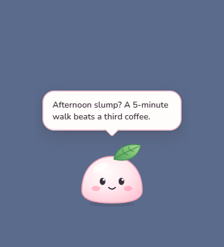

# Mochi

A cute desk mascot for Windows that pops short, helpful tips on your screen, picked by the app you use, the time of day and your breaks.



## Install

Download `Mochi-setup.exe` from the [latest release](https://github.com/seifsg/mochi/releases/latest) and run it (Windows 10 or 11). Mochi appears at the bottom-right of your screen. Until the first release is out, run it from source (below).

- Drag Mochi anywhere. Tap Mochi for a tip; tap the bubble to hide it.
- Right-click the tray icon: **Show a tip**, **Mute tips**, **Start with Windows**, **Quit Mochi**.

## Run from source

Needs Node 22+, Rust stable (MSVC build tools on Windows) and WebView2 (built into Windows 11).

```bash
npm ci
npm run app:dev
```

`npm run app:build` builds the installer into `src-tauri/target/release/bundle/nsis/`.

## Develop

| Command | Does |
|---|---|
| `npm test` | tip-picking tests |
| `npm run check` | strict typecheck, tests, `cargo clippy` |
| `npm run dev` | landing page dev server |
| `npm run build` | landing page into `dist/` |

Tips live in [`shared/tips.json`](shared/tips.json). Each tip has an `id`, a `text` (up to 160 characters) and at most one of: `apps` (exe names such as `code` or `excel`), `idle: true` (welcome back), or `times` (`morning`, `afternoon`, `evening`, `night`). Run `npm test` after editing.

## Privacy

No network, no account, no AI. Mochi reads only your idle time and the foreground app's exe name, on your PC, to pick a tip.

MIT license.

🏭 Built with [AI Software Factory](https://softwarefactory.company/) by Seif
